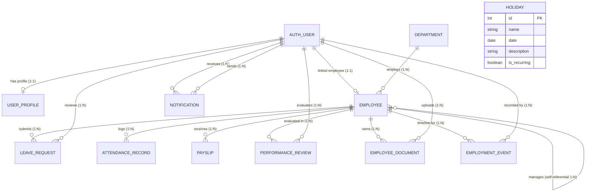

# Employee Management System (EMS) — In-Depth Technical Specification & Architecture Description

> **Document Version:** 2.0.0  
> **Target Audience:** Engineering Leads, Software Architects, Full-Stack Developers, DevOps Engineers, and System Administrators  
> **Repository:** [PRODIGY_FS_02](https://github.com/jho-G/PRODIGY_FS_02)  
> **Branch:** `react_and_drf`  
> **Last Updated:** October 2026  

---

## Table of Contents

1. [Executive Summary & System Vision](#1-executive-summary--system-vision)
2. [High-Level System Architecture](#2-high-level-system-architecture)
3. [Technology Stack & Architectural Rationale](#3-technology-stack--architectural-rationale)
4. [Domain Model & Relational Database Design](#4-domain-model--relational-database-design)
5. [Authentication, Authorization & RBAC Matrix](#5-authentication-authorization--rbac-matrix)
6. [API Surface & Endpoint Specifications](#6-api-surface--endpoint-specifications)
7. [Frontend Architecture & Client State Lifecycle](#7-frontend-architecture--client-state-lifecycle)
8. [Security Engineering, Rate Limiting & Hardening](#8-security-engineering-rate-limiting--hardening)
9. [DevOps, Containerization & SSL Deployment Runbook](#9-devops-containerization--ssl-deployment-runbook)
10. [Testing, Quality Assurance & Linting Pipelines](#10-testing-quality-assurance--linting-pipelines)
11. [Operational Runbook & Disaster Recovery](#11-operational-runbook--disaster-recovery)

---

## 1. Executive Summary & System Vision

The **Employee Management System (EMS)** is an enterprise-grade, full-stack human resource management platform engineered to streamline workforce administration, departmental organization, attendance tracking, leave request lifecycles, compensation payroll generation, performance reviews, organizational documents, and company-wide calendar holidays.

### 1.1 Core Business Objectives
- **Centralized Workforce Single Source of Truth:** Unify personnel records, employment status, reporting hierarchies, and compensation data within a single secure repository.
- **Operational Automation:** Replace manual paperwork with automated self-service workflows for employee leaves, daily attendance clocking, and automated monthly payroll calculation.
- **Hierarchical Governance & Compliance:** Enforce granular Role-Based Access Control (RBAC) ensuring employees, managers, HR officers, and system administrators only view and mutate data within their designated authorization boundaries.
- **Decoupled Modern UX:** Provide responsive, snappy, dark/light themed interactions powered by a single-page React frontend paired with a stateless, secure Django REST Framework API.

---

## 2. High-Level System Architecture

The application implements a decoupled client-server architecture with an API gateway/reverse proxy layer for production security and static asset offloading:

```
+-----------------------------------------------------------------------+
|                             Client Layer                              |
|   +---------------------------------------------------------------+   |
|   |         React 18 Single-Page Application (Vite Bundler)       |   |
|   |   - Responsive UI (Dark/Light Modes, Lucide Icons)            |   |
|   |   - React Router DOM v6 Client-Side Routing                   |   |
|   |   - Centralized Axios Instance with Token Refresh Interceptor  |   |
|   +---------------------------------------------------------------+   |
+-----------------------------------▲-----------------------------------+
                                    │ HTTPS (Port 443 / Dev 5173)
                                    ▼
+-----------------------------------------------------------------------+
|                      Reverse Proxy & Ingress Layer                    |
|   +---------------------------------------------------------------+   |
|   |                  Nginx 1.25+ (Alpine Container)               |   |
|   |   - SSL/TLS Termination (Modern TLS 1.2/1.3)                  |   |
|   |   - Static Asset Serving (/assets/*, caching headers)         |   |
|   |   - Security Headers (HSTS, CSP, X-Frame-Options)             |   |
|   |   - Reverse Proxy: /api/* & /admin/* to Backend Container     |   |
|   +---------------------------------------------------------------+   |
+-----------------------------------▲-----------------------------------+
                                    │ HTTP (Internal Docker Network :8000)
                                    ▼
+-----------------------------------------------------------------------+
|                     Application & Business Logic Layer                |
|   +---------------------------------------------------------------+   |
|   |           Django 5.x + Django REST Framework (Gunicorn)       |   |
|   |   - SimpleJWT Authentication & Token Blacklisting             |   |
|   |   - Custom RBAC Permissions (IsAdminOrHR, IsSelfOrHR, etc.)   |   |
|   |   - Resource ViewSets & Serializer Validation Pipelines       |   |
|   |   - IP Rate Limiting (django-ratelimit) & Throttling          |   |
|   |   - Management Commands (Mock Data Seeding, Report Export)     |   |
|   +---------------------------------------------------------------+   |
+-----------------------------------▲-----------------------------------+
                                    │ SQL Queries (ORM Abstraction)
                                    ▼
+-----------------------------------------------------------------------+
|                         Persistence & Media Layer                     |
|   +-----------------------------------+---------------------------+   |
|   |    Relational Database            |   Media & Storage Volume  |   |
|   |    - SQLite 3 (Dev / Zero-config) |   - Employee Documents    |   |
|   |    - PostgreSQL 15+ (Production)  |   - Profile Avatars       |   |
|   +-----------------------------------+---------------------------+   |
+-----------------------------------------------------------------------+
```

---

## 3. Technology Stack & Architectural Rationale

| Domain | Technology | Version | Rationale |
|---|---|---|---|
| **Backend Engine** | Python / Django | 3.11+ / 5.1 | High developer velocity, battle-tested ORM, built-in migration engine, and comprehensive security defaults against SQL injection and CSRF. |
| **API Framework** | Django REST Framework | 3.15+ | Industry standard for Python REST APIs; provides powerful serializers, model viewsets, content negotiation, and the interactive Browsable API. |
| **Authentication** | `djangorestframework-simplejwt` | 5.3+ | Stateless, cryptographically signed token exchange with token rotation and redis/database blacklisting for immediate revocation. |
| **Rate Limiting** | `django-ratelimit` | 4.1+ | IP-based request throttling protecting credential endpoints against brute-force credential stuffing. |
| **Configuration** | `python-decouple` | 3.8+ | Adherence to 12-Factor App methodology; isolates runtime environment variables from source control. |
| **Frontend Framework** | React | 18.3 | Component-driven declarative UI, virtual DOM rendering performance, and rich ecosystem. |
| **Build Tool** | Vite | 5.4 | Sub-second Hot Module Replacement (HMR), tree-shaking, and optimized Rollup production bundling. |
| **HTTP Client** | Axios | 1.7 | First-class interceptor support enabling transparent 401 token refresh queue handling. |
| **Icons & UI** | Lucide React | 0.447 | Crisp, modern, customizable SVG icon library with zero runtime bloat. |
| **Routing** | React Router DOM | 6.26 | Declarative client-side routing, protected route guards, and nested layout nesting. |
| **Gateway / Proxy** | Nginx Alpine | 1.25+ | Lightweight, high-throughput static file delivery, SSL offloading, and backend request forwarding. |
| **Containerization**| Docker & Docker Compose | 24+ / v2 | Deterministic multi-stage image builds ensuring parity across local development and production environments. |
| **Code Quality** | Ruff & Oxlint | Latest | High-speed Rust-based linters and formatters ensuring clean, consistent, PEP8-compliant code across all teams. |

---

## 4. Domain Model & Relational Database Design

The data persistence layer is constructed with Django ORM models, enforcing database-level constraints (foreign keys, uniqueness, check constraints, default values, and indexes) to guarantee ACID integrity.

### 4.1 Entity-Relationship (ER) Diagram



### 4.2 Detailed Model Specifications

#### 1. UserProfile (`employees.models.UserProfile`)
Extends the standard Django `auth.User` model with enterprise application metadata and RBAC roles.
- `user` (`OneToOneField` -> `User`, `CASCADE`, `related_name='profile'`): The associated Django auth user.
- `role` (`CharField`, choices: `ADMIN`, `HR`, `MANAGER`, `EMPLOYEE`, default `EMPLOYEE`): Determines system privileges and navigation authorization.
- `phone_number` (`CharField`, max_length=20, blank=True): Contact phone.
- `avatar` (`ImageField`, upload_to='avatars/', blank=True, null=True): Profile image asset.
- `created_at` / `updated_at` (`DateTimeField`): Automatic auditing timestamps.

#### 2. Department (`employees.models.Department`)
Represents an organizational business unit or department.
- `name` (`CharField`, max_length=100, unique=True, indexed): Canonical department name (e.g., *Engineering*, *Marketing*).
- `description` (`TextField`, blank=True): Department charter and functional scope.
- `created_at` / `updated_at` (`DateTimeField`): Audit timestamps.
- **Computed Properties:** `active_employees_count` dynamically aggregates active employees assigned to this department via `self.employees.filter(is_active=True).count()`.

#### 3. Employee (`employees.models.Employee`)
The central entity representing an individual staff member.
- `user` (`OneToOneField` -> `User`, `null=True`, `blank=True`, `SET_NULL`, `related_name='employee_profile'`): Links an employee to system login credentials.
- `department` (`ForeignKey` -> `Department`, `SET_NULL`, `null=True`, `related_name='employees'`): Organizational unit assignment.
- `manager` (`ForeignKey` -> `'self'`, `SET_NULL`, `null=True`, `blank=True`, `related_name='subordinates'`): Hierarchical supervisor.
- `employee_id` (`CharField`, max_length=20, unique=True, indexed): Enterprise badge ID (e.g., `EMP-1001`).
- `first_name`, `last_name` (`CharField`, max_length=100): Legal name fields.
- `email` (`EmailField`, unique=True, indexed): Professional communication email.
- `phone_number` (`CharField`, max_length=20): Primary telephone with regex format validation.
- `position` (`CharField`, max_length=100): Job title / designation.
- `hire_date` (`DateField`): First day of active employment.
- `birth_date` (`DateField`): Date of birth for age calculation and compliance.
- `employment_status` (`CharField`, choices: `FT` (Full-Time), `PT` (Part-Time), `CT` (Contract), `IN` (Intern)): Employment classification.
- `salary` (`DecimalField`, max_digits=10, decimal_places=2): Annual baseline compensation.
- `prior_experience_years` (`DecimalField`, default=0.0): Documented professional experience prior to joining.
- `annual_leave_days` (`PositiveIntegerField`, default=20): Contractual yearly paid leave entitlement.
- `bank_account`, `bank_name`, `tax_id` (`CharField`, blank=True): Payroll and tax disbursement metadata.
- `emergency_contact_name`, `emergency_contact_phone`, `emergency_contact_relation`: Crisis contact information.
- `is_active` (`BooleanField`, default=True, indexed): Enables safe soft-deletion without breaking foreign key integrity.
- **Computed Attributes:**
  - `full_name`: Combined first and last name.
  - `age`: Exact calculated chronological age.
  - `service_years`: Fractional years of tenure derived from `hire_date`.
  - `effective_experience_years`: Total sum of prior experience and current company tenure.
  - `salary_monthly`: Derived `salary / 12`.

#### 4. LeaveRequest (`employees.models.LeaveRequest`)
Manages the lifecycle of time-off requests.
- `employee` (`ForeignKey` -> `Employee`, `CASCADE`, `related_name='leave_requests'`): Staff applicant.
- `leave_type` (`CharField`, choices: `VL` (Vacation), `SL` (Sick), `PL` (Personal), `ML` (Maternity/Paternity), `UL` (Unpaid)).
- `start_date`, `end_date` (`DateField`): Inclusive date interval.
- `leave_days` (`PositiveIntegerField`): Working days consumed.
- `reason` (`TextField`): Justification provided by applicant.
- `status` (`CharField`, choices: `PENDING`, `APPROVED`, `REJECTED`, `CANCELLED`, default `PENDING`).
- `reviewer` (`ForeignKey` -> `User`, `SET_NULL`, `null=True`, `blank=True`): HR officer or manager who evaluated the request.
- `reviewed_at` (`DateTimeField`, null=True, blank=True): Timestamp of review action.
- `rejection_reason` (`TextField`, blank=True): Constructive explanation when a request is rejected.

#### 5. AttendanceRecord (`employees.models.AttendanceRecord`)
Daily timekeeping ledger for each workforce member.
- `employee` (`ForeignKey` -> `Employee`, `CASCADE`, `related_name='attendance_records'`).
- `date` (`DateField`, default `timezone.now`): Attendance calendar date.
- `check_in`, `check_out` (`TimeField`, null=True, blank=True): Physical or remote timestamps.
- `status` (`CharField`, choices: `PRESENT`, `LATE`, `ABSENT`, `LEAVE`, `REMOTE`, default `PRESENT`).
- `ip_address` (`GenericIPAddressField`, null=True, blank=True): Geo/network validation audit trail.
- `notes` (`CharField`, max_length=255, blank=True): Optional shift annotations.
- `work_hours` (`DecimalField`, max_digits=4, decimal_places=2, default=0.0): Total daily productive hours.
- **Database Constraint:** `unique_together = ('employee', 'date')` guarantees that an employee cannot have duplicate attendance records for the same day.

#### 6. Payslip (`employees.models.Payslip`)
Detailed monthly compensation ledger and pay breakdown.
- `employee` (`ForeignKey` -> `Employee`, `CASCADE`, `related_name='payslips'`).
- `year` (`PositiveIntegerField`), `month` (`PositiveIntegerField`, 1–12): Accounting period.
- `basic_salary` (`DecimalField`): Contractual base wage for the pay cycle.
- `allowances` (`DecimalField`, default 0.00): Housing, transport, or utility allowances.
- `bonuses` (`DecimalField`, default 0.00): Performance awards or milestone bonuses.
- `deductions` (`DecimalField`, default 0.00): Unpaid leave or benefit withholdings.
- `tax_deductions` (`DecimalField`, default 0.00): Mandatory state/income withholding taxes.
- `net_pay` (`DecimalField`): Server-computed net payout: `(basic_salary + allowances + bonuses) - (deductions + tax_deductions)`.
- `status` (`CharField`, choices: `DRAFT`, `APPROVED`, `PAID`, default `DRAFT`).
- `paid_at` (`DateTimeField`, null=True, blank=True): Disbursement execution date.
- **Database Constraint:** `unique_together = ('employee', 'year', 'month')` prevents double payroll disbursement.

#### 7. PerformanceReview (`employees.models.PerformanceReview`)
Semi-annual or annual talent assessment and competency review.
- `employee` (`ForeignKey` -> `Employee`, `CASCADE`, `related_name='performance_reviews'`).
- `reviewer` (`ForeignKey` -> `User`, `SET_NULL`, null=True, `related_name='conducted_reviews'`).
- `review_period` (`CharField`, max_length=50): Cadence identifier (e.g., `2026-H1`, `2026-Q3`).
- `review_date` (`DateField`, default `timezone.now`): Formal evaluation date.
- `job_knowledge`, `work_quality`, `communication`, `teamwork`, `initiative` (`PositiveSmallIntegerField`, 1–5): Structured competency metrics.
- `overall_rating` (`DecimalField`, max_digits=3, decimal_places=2): Normalized average across competencies.
- `strengths`, `areas_for_improvement`, `goals` (`TextField`): Qualitative feedback and growth targets.
- `status` (`CharField`, choices: `DRAFT`, `COMPLETED`, `ACKNOWLEDGED`, default `DRAFT`).
- `acknowledged_at` (`DateTimeField`, null=True, blank=True): When the employee officially acknowledged the assessment.

#### 8. Holiday (`employees.models.Holiday`)
Organizational paid holidays and scheduled calendar observances.
- `name` (`CharField`, max_length=150): Holiday title (e.g., *New Year's Day*, *Labor Day*).
- `date` (`DateField`): The observed holiday date.
- `description` (`TextField`, blank=True): Historical or cultural context.
- `is_recurring` (`BooleanField`, default=False): Flag indicating whether the date recurs annually.

#### 9. EmploymentEvent (`employees.models.EmploymentEvent`)
Chronological career milestone and audit log for each employee.
- `employee` (`ForeignKey` -> `Employee`, `CASCADE`, `related_name='timeline_events'`).
- `event_type` (`CharField`, choices: `HIRED`, `PROMOTED`, `SALARY_CHANGE`, `DEPARTMENT_TRANSFER`, `ROLE_CHANGE`, `STATUS_CHANGE`, `TERMINATED`).
- `event_date` (`DateField`, default `timezone.now`): Date event occurred.
- `notes` (`TextField`, blank=True): Details, previous title, new salary, or transfer notes.
- `recorded_by` (`ForeignKey` -> `User`, `SET_NULL`, null=True, blank=True): Audit author.

#### 10. EmployeeDocument (`employees.models.EmployeeDocument`)
Encrypted or secure file storage for official employee records.
- `employee` (`ForeignKey` -> `Employee`, `CASCADE`, `related_name='documents'`).
- `title` (`CharField`, max_length=200): Descriptive document title.
- `document_type` (`CharField`, choices: `CONTRACT`, `ID_PROOF`, `RESUME`, `CERTIFICATE`, `TAX_FORM`, `OTHER`).
- `file` (`FileField`, upload_to='employee_documents/%Y/%m/'): Document binary storage.
- `notes` (`TextField`, blank=True): Supplemental file metadata.
- `uploaded_by` (`ForeignKey` -> `User`, `SET_NULL`, null=True, blank=True): Audit track.

#### 11. Notification (`employees.models.Notification`)
In-app operational and system alert dispatch.
- `recipient` (`ForeignKey` -> `User`, `CASCADE`, `related_name='notifications'`).
- `sender` (`ForeignKey` -> `User`, `SET_NULL`, null=True, blank=True): Dispatched user.
- `title` (`CharField`, max_length=200): Notification heading.
- `message` (`TextField`): Body content.
- `notification_type` (`CharField`, choices: `LEAVE`, `ATTENDANCE`, `PAYSLIP`, `PERFORMANCE`, `SYSTEM`, `GENERAL`).
- `is_read` (`BooleanField`, default=False, indexed): Read state flag.
- `link` (`CharField`, max_length=255, blank=True): Client-side routing path (e.g., `/leaves/12`).

---

## 5. Authentication, Authorization & RBAC Matrix

### 5.1 JSON Web Token (JWT) Architecture

The application has migrated away from legacy stateful session authentication to stateless cryptographically verified JSON Web Tokens powered by `djangorestframework-simplejwt`.

```
                       JWT Token Exchange & Lifecycle
                       
   [ Client Browser ]                                  [ EMS Django Backend ]
          │                                                       │
   (1)    │── POST /api/auth/login/ {username, password} ─────────│
          │                                                       │ (Validates credentials)
          │                                                       │ (Generates custom claims)
   (2)    │◀─ 200 OK {access: "<jwt>", refresh: "<jwt>", user} ───│
          │                                                       │
     [Stores tokens]                                              │
     [Sets Authorization: Bearer <access>]                        │
          │                                                       │
   (3)    │── GET /api/employees/ [Bearer access] ────────────────│
          │◀─ 200 OK [Data payload] ──────────────────────────────│
          │                                                       │
     (15 mins elapse -> access token expires)                     │
          │                                                       │
   (4)    │── GET /api/leaves/ [Expired access] ──────────────────│
          │◀─ 401 Unauthorized (token_not_valid) ─────────────────│
          │                                                       │
   (5)    │── POST /api/auth/token/refresh/ {refresh: "<jwt>"} ───│
          │                                                       │ (Rotates token)
          │                                                       │ (Blacklists old refresh)
   (6)    │◀─ 200 OK {access: "<new_jwt>", refresh: "<new_jwt>"} ─│
          │                                                       │
   (7)    │── Re-attempts original request with new access token ─│
          │◀─ 200 OK [Data payload] ──────────────────────────────│
          │                                                       │
   (8)    │── POST /api/auth/logout/ {refresh: "<jwt>"} ──────────│
          │                                                       │ (Blacklists refresh)
          │◀─ 200 OK {"message": "Logged out successfully."} ─────│
```

#### Custom Token Payload (`EMSRefreshToken`)
Rather than forcing the client to make secondary network roundtrips to identify the user's role and associated employee record, the backend generates a customized token embedding essential identity claims:

```json
{
  "token_type": "access",
  "exp": 1791730800,
  "iat": 1791729900,
  "jti": "8f3b25e79b9b4f988220021c3b17c1bf",
  "user_id": 4,
  "username": "sarah_connor",
  "email": "sarah@acme.corp",
  "role": "HR",
  "employee_id": "EMP-1042",
  "department_id": 2
}
```

### 5.2 Role-Based Access Control (RBAC) Matrix

The system enforces a 4-tier hierarchical access model:

| Module / Operation | Admin | HR | Manager | Employee |
|---|:---:|:---:|:---:|:---:|
| **Authentication & Profile Self-Service** |
| Login / Refresh / Logout | :white_check_mark: | :white_check_mark: | :white_check_mark: | :white_check_mark: |
| View own profile (`/api/auth/me/`) | :white_check_mark: | :white_check_mark: | :white_check_mark: | :white_check_mark: |
| Update own password | :white_check_mark: | :white_check_mark: | :white_check_mark: | :white_check_mark: |
| **Department Management** |
| List departments & employee counts | :white_check_mark: | :white_check_mark: | :white_check_mark: | :white_check_mark: |
| Create / Update department details | :white_check_mark: | :white_check_mark: | :x: | :x: |
| Delete department | :white_check_mark: | :x: | :x: | :x: |
| **Employee Directory** |
| View employee directory & public profiles | :white_check_mark: | :white_check_mark: | :white_check_mark: | :white_check_mark: |
| View confidential data (salary, tax ID, bank) | :white_check_mark: | :white_check_mark: | :x: | Self only |
| Create new employee record | :white_check_mark: | :white_check_mark: | :x: | :x: |
| Update employee details | :white_check_mark: | :white_check_mark: | :x: | :x: |
| Soft-deactivate employee (`is_active=False`) | :white_check_mark: | :white_check_mark: | :x: | :x: |
| Permanent hard-delete (`?hard=true`) | :white_check_mark: | :x: | :x: | :x: |
| Export employee list to CSV | :white_check_mark: | :white_check_mark: | :x: | :x: |
| Workforce analytics (`/api/employees/stats/`)| :white_check_mark: | :white_check_mark: | :white_check_mark: | :x: |
| **Leave Management** |
| Submit leave request | :white_check_mark: | :white_check_mark: | :white_check_mark: | :white_check_mark: (own) |
| Cancel own pending leave | :white_check_mark: | :white_check_mark: | :white_check_mark: | :white_check_mark: (own) |
| Approve / Reject leave requests | :white_check_mark: | :white_check_mark: | :white_check_mark: (direct reports) | :x: |
| View all organization leave requests | :white_check_mark: | :white_check_mark: | Direct reports only | Self only |
| **Attendance & Timekeeping** |
| Daily Clock-in / Clock-out | :white_check_mark: | :white_check_mark: | :white_check_mark: | :white_check_mark: (own) |
| View own attendance records | :white_check_mark: | :white_check_mark: | :white_check_mark: | :white_check_mark: (own) |
| View team attendance summary | :white_check_mark: | :white_check_mark: | Direct reports only | :x: |
| Override / Edit attendance logs | :white_check_mark: | :white_check_mark: | :x: | :x: |
| **Payroll & Payslips** |
| View own monthly payslips | :white_check_mark: | :white_check_mark: | :white_check_mark: | :white_check_mark: (own) |
| Generate bulk monthly payslips | :white_check_mark: | :white_check_mark: | :x: | :x: |
| Mark payslip as paid / adjust salary items | :white_check_mark: | :white_check_mark: | :x: | :x: |
| View organization payroll totals | :white_check_mark: | :white_check_mark: | :x: | :x: |
| **Performance Reviews** |
| Create / Conduct performance evaluation | :white_check_mark: | :white_check_mark: | :white_check_mark: (direct reports) | :x: |
| Complete review and finalize score | :white_check_mark: | :white_check_mark: | :white_check_mark: | :x: |
| Acknowledge review feedback | :white_check_mark: | :white_check_mark: | :white_check_mark: | :white_check_mark: (reviewed employee) |
| Organization performance metrics | :white_check_mark: | :white_check_mark: | :x: | :x: |
| **Documents & Holidays** |
| Upload employee contracts & records | :white_check_mark: | :white_check_mark: | :x: | :x: |
| Download own employee documents | :white_check_mark: | :white_check_mark: | :x: | Self only |
| View organization holiday calendar | :white_check_mark: | :white_check_mark: | :white_check_mark: | :white_check_mark: |
| Add / Delete company holidays | :white_check_mark: | :white_check_mark: | :x: | :x: |

---

## 6. API Surface & Endpoint Specifications

Base URI: `http://localhost:8000/api/` (Direct) or `https://localhost/api/` (via Nginx Ingress)

All protected endpoints require an Authorization header:
```http
Authorization: Bearer <access_token>
```

### 6.1 Authentication Endpoints (`/api/auth/*`)

| Method | Endpoint | Auth | Purpose | Request Body / Params | Expected Response |
|---|---|:---:|---|---|---|
| `POST` | `/api/auth/login/` | No | Authenticate user & issue JWT pair | `{"username": "...", "password": "..."}` | `200 OK`: `{access, refresh, user}` |
| `POST` | `/api/auth/token/refresh/` | No | Rotate expired access token | `{"refresh": "..."}` | `200 OK`: `{access, refresh}` |
| `POST` | `/api/auth/token/verify/` | No | Verify token integrity & expiry | `{"token": "..."}` | `200 OK`: `{}` |
| `POST` | `/api/auth/logout/` | Bearer | Blacklist refresh token & terminate session | `{"refresh": "..."}` | `200 OK`: `{"message": "Logged out successfully."}` |
| `GET` | `/api/auth/me/` | Bearer | Self-service current employee profile | None | `200 OK`: Full Employee record |
| `GET` | `/api/auth/user/` | Bearer | Current Django user identity & role | None | `200 OK`: `{id, username, email, role, employee_id}` |

### 6.2 Department Endpoints (`/api/departments/*`)

| Method | Endpoint | Auth | Purpose | Query Parameters / Body |
|---|---|:---:|---|---|
| `GET` | `/api/departments/` | Bearer | List departments with employee count | `?search=<term>` |
| `POST` | `/api/departments/` | Bearer (HR/Admin) | Create new department | `{"name": "...", "description": "..."}` |
| `GET` | `/api/departments/{id}/` | Bearer | Retrieve single department detail | None |
| `PUT`/`PATCH` | `/api/departments/{id}/` | Bearer (HR/Admin) | Update department properties | `{"description": "..."}` |
| `DELETE` | `/api/departments/{id}/` | Bearer (Admin) | Delete department (must have 0 staff) | None |

### 6.3 Employee Directory Endpoints (`/api/employees/*`)

| Method | Endpoint | Auth | Purpose | Query Parameters / Body |
|---|---|:---:|---|---|
| `GET` | `/api/employees/` | Bearer | Paginated search & filtered list | `?search=`, `?department=`, `?employment_status=`, `?is_active=`, `?min_salary=`, `?page=` |
| `POST` | `/api/employees/` | Bearer (HR/Admin) | Register new employee | Full employee profile JSON |
| `GET` | `/api/employees/{id}/` | Bearer | Full profile with calculated metrics | Returns age, service_years, monthly salary |
| `PUT`/`PATCH` | `/api/employees/{id}/` | Bearer (HR/Admin) | Update employee profile | Partial or complete profile JSON |
| `DELETE` | `/api/employees/{id}/` | Bearer (HR/Admin) | Soft delete (`?hard=true` for Admin hard-delete) | `?hard=true` (optional) |
| `POST` | `/api/employees/{id}/restore/` | Bearer (HR/Admin) | Restore soft-deactivated employee | None |
| `GET` | `/api/employees/stats/` | Bearer (Manager+) | High-level workforce metric dashboard | Returns counts, avg salary, department breakdown |
| `GET` | `/api/employees/export/` | Bearer (HR/Admin) | Export filtered employee directory as CSV | Same filters as `GET /api/employees/` |

### 6.4 Leave Management Endpoints (`/api/leaves/*`)

| Method | Endpoint | Auth | Purpose | Details |
|---|---|:---:|---|---|
| `GET` | `/api/leaves/` | Bearer | List leave requests (scoped to role) | `?status=PENDING&leave_type=VL&employee=<id>` |
| `POST` | `/api/leaves/` | Bearer | Submit a new leave request | `{"leave_type": "VL", "start_date": "...", "end_date": "...", "reason": "..."}` |
| `POST` | `/api/leaves/{id}/approve/` | Bearer (Manager+) | Approve pending leave | Sets status to `APPROVED`, records reviewer |
| `POST` | `/api/leaves/{id}/reject/` | Bearer (Manager+) | Reject pending leave with explanation | `{"rejection_reason": "Project deadline collision"}` |
| `POST` | `/api/leaves/{id}/cancel/` | Bearer (Self/HR) | Cancel pending or approved request | Restores employee leave balance |

### 6.5 Attendance Endpoints (`/api/attendance/*`)

| Method | Endpoint | Auth | Purpose | Details |
|---|---|:---:|---|---|
| `GET` | `/api/attendance/` | Bearer | List time records | Filter by `date`, `date_after`, `date_before`, `status` |
| `POST` | `/api/attendance/` | Bearer | Log attendance entry | Date, initial status, employee |
| `POST` | `/api/attendance/{id}/check_in/` | Bearer | Record check-in timestamp | Auto-flags `LATE` if after 09:00 AM |
| `POST` | `/api/attendance/{id}/check_out/` | Bearer | Record check-out timestamp | Automatically computes `work_hours` |
| `GET` | `/api/attendance/summary/` | Bearer | Monthly workforce attendance recap | `?year=2026&month=10` |

### 6.6 Payroll Endpoints (`/api/payslips/*`)

| Method | Endpoint | Auth | Purpose | Details |
|---|---|:---:|---|---|
| `GET` | `/api/payslips/` | Bearer | List payslips | Scoped to own for employee; all for HR/Admin |
| `POST` | `/api/payslips/` | Bearer (HR/Admin) | Create individual payslip | Basic salary, allowances, deductions |
| `POST` | `/api/payslips/generate/` | Bearer (HR/Admin) | Bulk generate payroll for cycle | `{"year": 2026, "month": 10}` |
| `GET` | `/api/payslips/summary/` | Bearer (HR/Admin) | Aggregate payroll expenses | Gross payroll, tax withheld, net disbursement |

### 6.7 Performance Reviews (`/api/performance-reviews/*`)

| Method | Endpoint | Auth | Purpose | Details |
|---|---|:---:|---|---|
| `GET` | `/api/performance-reviews/` | Bearer | List reviews | Filter by `employee`, `period`, `status` |
| `POST` | `/api/performance-reviews/` | Bearer (Manager+) | Create review draft | 1-5 scores for 5 competency dimensions |
| `POST` | `/api/performance-reviews/{id}/complete/` | Bearer (Manager+) | Finalize evaluation | Transitions status to `COMPLETED` |
| `POST` | `/api/performance-reviews/{id}/acknowledge/` | Bearer (Employee) | Acknowledge review | Sets `acknowledged_at` timestamp |
| `GET` | `/api/performance-reviews/summary/` | Bearer (HR/Admin) | Org rating distribution | Average ratings and top performers |

### 6.8 Supporting Resource Endpoints

- **Holidays (`/api/holidays/`):** Full CRUD for company holidays. Read-only for general staff; write for HR/Admin.
- **Documents (`/api/documents/`):** Multipart file uploads for employee records, contracts, certificates, and ID proofs.
- **Employment Events (`/api/employment-events/`):** Career history timeline entries (promotions, transfers, wage updates).
- **Notifications (`/api/notifications/`):** User notifications with `/mark_all_read/` and `/unread_count/` convenience endpoints.

---

## 7. Frontend Architecture & Client State Lifecycle

The frontend application is constructed with **React 18** and packaged via **Vite**, delivering an SPA (Single-Page Application) experience.

### 7.1 Directory Layout & Component Hierarchy

```text
frontend/src/
├── api/
│   ├── client.js           # Axios instance, request/response interceptors & token queue
│   └── endpoints.js        # Declarative API URL route constants & helper wrappers
├── context/
│   └── AuthContext.jsx     # Context provider managing auth state, tokens & RBAC predicates
├── components/
│   ├── ProtectedRoute.jsx  # Route guard redirecting unauthenticated users to /login
│   ├── Layout.jsx          # Shell with responsive sidebar, top navbar & notification popover
│   ├── Sidebar.jsx         # Role-aware navigation drawer with Lucide icons
│   ├── Navbar.jsx          # Header with user profile menu, breadcrumbs & theme toggler
│   ├── EmployeeModal.jsx   # Form dialog for creating/editing employee records
│   ├── EmployeeDetailModal.jsx # Comprehensive modal displaying tabbed profile details
│   └── StatCard.jsx        # Dashboard metric widget with micro-animations
├── pages/
│   ├── Login.jsx           # JWT credential sign-in page with validation & error toasts
│   ├── Dashboard.jsx       # Aggregated KPIs, charts, quick links & upcoming holidays
│   ├── Employees.jsx       # Full directory with search, department filtering, pagination & CSV export
│   ├── Departments.jsx     # Department cards with member rosters and active counts
│   ├── Leave.jsx           # Leave balance cards, calendar requests & approval workflow
│   ├── Attendance.jsx      # Punch in/out widget, monthly calendar grid & hours tracking
│   ├── Payroll.jsx         # Payslip generator, salary table, net calculation & PDF downloads
│   └── Performance.jsx     # Competency scorecards, manager evaluations & employee acknowledgement
├── styles/
│   ├── index.css           # Global CSS reset, typography, and utility tokens
│   └── App.css             # Component-level styling & custom responsive layout rules
├── App.jsx                 # Route definition table wrapped with AuthProvider
└── main.jsx                # React root mount point
```

### 7.2 Interceptor Token Refresh Queue

When a JWT access token expires after 15 minutes, ongoing background requests could trigger multiple simultaneous 401 errors. The Axios client handles this with a FIFO queue and mutex flag:

1. **Request Interceptor:**
   - Reads `access_token` from `localStorage`.
   - Injects `Authorization: Bearer <access_token>` into outgoing request headers.

2. **Response Interceptor & Queue Mechanism:**
   - Detects `error.response?.status === 401`.
   - Checks if a refresh request is already running (`isRefreshing = true`).
   - If a refresh is already underway, it creates a pending Promise, pushes it to `failedQueue`, and waits.
   - If no refresh is underway, it acquires the mutex (`isRefreshing = true`), extracts `refresh_token` from `localStorage`, and posts to `/api/auth/token/refresh/`.
   - **Upon Success:** Stores the new access & refresh tokens in `localStorage`, notifies all queued promises with `processQueue(null, newAccessToken)`, and retries the original request.
   - **Upon Failure:** Triggers `logout()`, clears `localStorage`, rejects all queued promises with `processQueue(error, null)`, and redirects the user to `/login`.

### 7.3 AuthContext & Role-Based UI Rendering

The `AuthContext` provides global authentication state and helper booleans consumed throughout the UI:
- `user`: Holds decoded token identity `{ id, username, email, role, employee_id }`.
- `isAuthenticated`: Boolean state verifying active token session.
- `isAdmin`: `user?.role === 'ADMIN'`.
- `isHR`: `user?.role === 'HR' || user?.role === 'ADMIN'`.
- `isManager`: `['ADMIN', 'HR', 'MANAGER'].includes(user?.role)`.
- `login(username, password)`: Exchanges credentials with `/api/auth/login/`.
- `logout()`: Posts refresh token to `/api/auth/logout/` for blacklisting, wipes client storage, and resets state.

UI components consume these flags to conditionally render administrative controls:
```jsx
{isHR && (
  <button onClick={() => setShowAddModal(true)} className="btn-primary">
    <UserPlus size={16} /> Add Employee
  </button>
)}
```

### 7.4 Design System & Visual Aesthetics

- **Color Palette:** HSL-tailored primary indigo/blue accents (`hsl(222, 47%, 11%)` dark surface, `hsl(217, 91%, 60%)` vibrant brand accent).
- **Dark Mode Support:** Automatic media query detection and user manual toggle with CSS custom properties.
- **Glassmorphism:** Modern backdrop blur panels (`backdrop-filter: blur(12px)`) on modals and navigation headers.
- **Micro-Interactions:** CSS transforms, subtle hover elevation, loading skeletons, and interactive state feedback.


